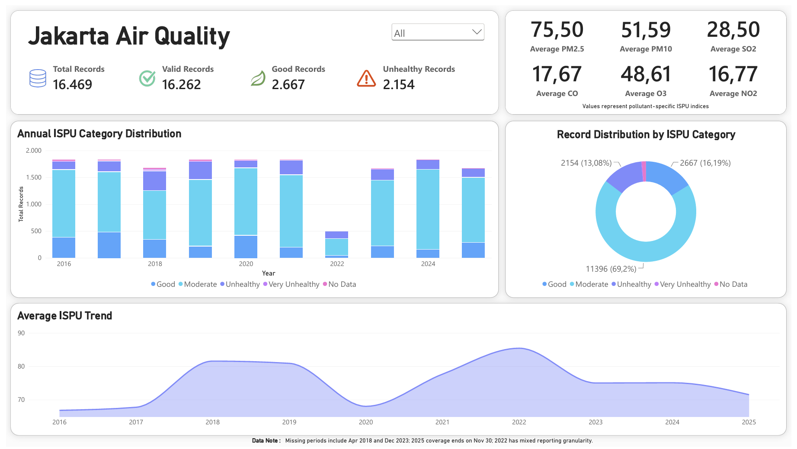
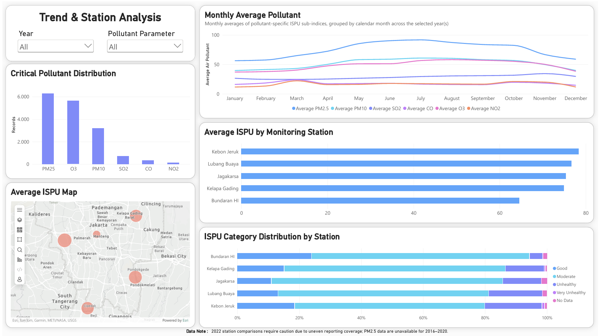

# 🌏 Jakarta Air Quality Analysis (2016–2025)

**An end-to-end data analytics project using Microsoft Excel, PostgreSQL, and Power BI to explore Jakarta's Air Pollution Standard Index (ISPU), examine pollutant-specific index patterns, and compare records across monitoring stations.**

The goal is to move from **raw air-quality records → structured analysis → interactive data exploration**.

> **Project scope:** This project provides a descriptive analysis of the available ISPU records. It does not represent a complete assessment of Jakarta's ambient air quality and does not establish causal relationships. Findings must be interpreted in the context of source-data coverage and reporting limitations.

---

## 📊 Dashboard Screenshots

### Overview



### Trends & Station Analysis



---

## 📌 Project Overview

This project analyzes daily ISPU records for Jakarta from 2016 to November 2025. The work covers source-data consolidation and manual preparation in Excel, data-quality checks and analytical queries in PostgreSQL, and interactive dashboard development in Power BI.

The analysis focuses on five monitoring stations (DKI1–DKI5), the distribution of reported ISPU categories, annual and monthly patterns in pollutant-specific ISPU sub-indices, and the pollutant most frequently identified as the critical parameter associated with the maximum ISPU value.

## 🎯 Project Objectives

- Examine the distribution of ISPU categories across the available observation period.
- Explore changes in Unhealthy records over time.
- Identify which pollutant most frequently appears as the critical parameter associated with the maximum ISPU value.
- Explore monthly patterns in pollutant-specific ISPU sub-indices, particularly PM2.5.
- Compare station-level records while accounting for differences in reporting coverage.
- Communicate data-quality issues and limitations that affect interpretation.

## 📁 Dataset Information

The dataset was sourced from **[Satu Data Jakarta](https://satudata.jakarta.go.id/)** and consolidated for this analysis.

| Attribute | Description |
|---|---|
| Source | Satu Data Jakarta |
| Observation period | 1 January 2016 – 30 November 2025 |
| Raw worksheet records | 16,501 |
| Cleaned records | 16,469 |
| Number of fields | 15 |
| Monitoring stations | 5 (DKI1–DKI5) |
| Cleaned data format | CSV |

### Main Fields

| Field | Description |
|---|---|
| `date` | Observation date |
| `data_period` | Reporting period in `YYYYMM` format |
| `station_source` | Monitoring-station identifier (DKI1–DKI5) |
| `station_location` | Monitoring-station location |
| `pm25`, `pm10`, `so2`, `co`, `o3`, `no2` | Pollutant-specific ISPU sub-index values provided in the source dataset |
| `max` | Maximum reported ISPU component value for the observation |
| `critical` | Parameter associated with the maximum value |
| `category` | Original category label from the source data |
| `category_revised` | Standardized English category used in this analysis |

**Data interpretation note:** The pollutant fields are treated as ISPU sub-index values, not raw ambient pollutant concentrations. Refer to the [Data Dictionary](Documentation/data_dictionary.md) for all field definitions and data types.

### Data Quality Checks

The preparation and validation process included:

- Reviewing date, reporting-period, station, and pollutant fields.
- Checking missing values and inconsistent entries.
- Reviewing station coverage and annual record distribution.
- Checking duplicate combinations of observation date and station identifier.
- Standardizing selected station and category representations.
- Reconciling raw and cleaned record counts.

The cleaned dataset contains **16,469 records**, compared with **16,501 records** in the raw worksheet. The duplicate check returned **zero duplicate date–station combinations**. The 32-record difference is explained by 31 lower-granularity December 2022 records not retained and one empty record dated outside its reporting period—not by 32 confirmed duplicate rows.

---

## 🛠️ Tools & Technologies

| Tool | Purpose |
|---|---|
| Microsoft Excel | Source consolidation, manual data preparation, quality checks, PivotTables, and summaries |
| PostgreSQL | Data storage and SQL-based analysis |
| Power BI | Interactive dashboard, KPI cards, trends, station comparisons, and map visualization |
| GitHub | Project documentation and version control |

## 📈 Key Performance Indicators

| KPI | Result |
|---|---:|
| Total Records | 16,469 |
| Valid Records | 16,262 |
| Good Records | 2,667 |
| Unhealthy Records | 2,154 |
| Average PM2.5 ISPU sub-index | 75.50 |
| Average PM10 ISPU sub-index | 51.59 |
| Average SO₂ ISPU sub-index | 28.50 |
| Average CO ISPU sub-index | 17.67 |
| Average O₃ ISPU sub-index | 48.61 |
| Average NO₂ ISPU sub-index | 16.77 |

*The pollutant averages above are the overall values displayed in the Power BI report. They represent pollutant-specific ISPU sub-indices, not ambient concentration measurements.*

---

## 🔍 Key Analysis & Findings

The SQL analysis is organized around questions that help explain the available records. The findings below are descriptive; they do not identify the causes of changes in air quality.

### 1. What ISPU category appears most frequently?

The **Moderate** category dominates the cleaned dataset, accounting for **11,396 records (approximately 69.2%)**. Good accounts for 2,667 records (16.2%), while Unhealthy accounts for 2,154 records (13.1%). Very Unhealthy appears in 45 records. A further 207 records are labelled No Data.

This indicates that most records in the available dataset fall within the Moderate category. It should not be interpreted as a statement that Jakarta's air quality was Moderate on 69.2% of all calendar days, because the dataset has incomplete periods and uneven reporting granularity.

### 2. How did the number of Unhealthy records change over time?

The yearly count of Unhealthy records reached its highest value in **2018, with 365 records**. The count then fell to 143 in 2020, increased to 272 in 2021, and varied in subsequent years.

| Year | Unhealthy records | Change from previous year |
|---:|---:|---:|
| 2016 | 155 | — |
| 2017 | 198 | +43 |
| 2018 | 365 | +167 |
| 2019 | 337 | −28 |
| 2020 | 143 | −194 |
| 2021 | 272 | +129 |
| 2022 | 138 | −134 |
| 2023 | 203 | +65 |
| 2024 | 180 | −23 |
| 2025* | 163 | −17 |

*2025 covers January–November only. The 2022 value is affected by mixed reporting granularity: January–November has one selected-station record per date, while December has five station records per date. Therefore, the annual counts are not directly comparable as if each year had consistent station coverage.*

**Interpretation:** The yearly counts describe the records captured in the dataset. They should be read together with the number of records and stations represented in each year, rather than used alone to conclude that air quality improved or deteriorated.

### 3. Which pollutant was most frequently identified as the critical parameter?

The critical-pollutant analysis shows a clear shift in the available records:

- **2016–2020:** O₃ was the most frequently recorded critical parameter in each year.
- **2021–2025:** PM2.5 was the most frequently recorded critical parameter in each year.
- Across the full dataset, PM2.5 was identified as the critical parameter in **6,272 records**.

This finding describes which pollutant-specific ISPU sub-index most frequently corresponded to the maximum reported value. It does not establish the source of the pollutant or explain why the pattern changed. PM2.5 coverage is also incomplete, particularly before and after its initial appearance in the dataset.

### 4. Which monitoring station had the most Unhealthy records?

In the Q08 comparison, **Kebon Jeruk (DKI5) had the highest count with 598 Unhealthy records**, followed by Lubang Buaya (DKI4) with 484 records.

| Monitoring station | Unhealthy records |
|---|---:|
| Kebon Jeruk (DKI5) | 598 |
| Lubang Buaya (DKI4) | 484 |
| Jagakarsa (DKI3) | 401 |
| Kelapa Gading (DKI2) | 401 |
| Bundaran HI (DKI1) | 136 |

For this particular comparison, January–November 2022 was excluded because those months contain only one selected-station record per date; December 2022 was retained because it contains five station records per date.

**Interpretation:** These are record counts, not station-normalized rates. The ranking should not be presented as proof that Kebon Jeruk consistently has the worst air quality. A fairer comparison would require consistent observation coverage and valid-record denominators for each station.

### 5. When did the monthly average PM2.5 sub-index reach its highest value in each year?

The highest monthly averages in the available PM2.5 data were:

| Year | Month | Average PM2.5 ISPU sub-index | Valid records |
|---:|---|---:|---:|
| 2021 | July | 103.57 | 149 |
| 2022 | July | 110.39 | 31 |
| 2023 | October | 91.21 | 154 |
| 2024 | August | 88.52 | 155 |
| 2025* | June | 94.95 | 149 |

*2025 data are available through November only. July 2022 has just 31 valid records, compared with around 150 in several other listed months, reflecting the one-selected-station-per-day reporting pattern in January–November 2022. The 2022 monthly value is therefore not directly comparable with months represented by five stations.*

**Interpretation:** The monthly averages highlight when the highest reported PM2.5 sub-index values occurred within each year. They should be considered alongside valid-record counts and PM2.5 completeness; the figures do not by themselves explain the causes of monthly variation.

---

## 📊 Power BI Dashboard

An interactive two-page Power BI report was developed to let users explore category distribution, pollutant-specific patterns, and station-level records.

### Dashboard Features

**Overview**

- KPI cards for total records, valid records, Good records, and Unhealthy records.
- Cards showing average pollutant-specific ISPU sub-indices.
- Annual ISPU category distribution.
- Overall record distribution by ISPU category.
- Average ISPU trend by year.

**Trends & Station Analysis**

- Monthly averages of pollutant-specific ISPU sub-indices, with a pollutant-parameter selector.
- Critical pollutant distribution.
- Average ISPU by monitoring station.
- ISPU category distribution by station.
- Map visualization of monitoring-station locations and average ISPU values.
- Year filtering to explore selected periods.

---

## 💡 Analytical Implications & Next Steps

The results suggest several useful directions for further monitoring and analysis:

- **Improve PM2.5 data completeness.** PM2.5 has 9,440 missing values (57.32% of all cleaned records), despite being the most frequently identified critical parameter from 2021 onward in the available records.
- **Use station-normalized comparisons.** Future station comparisons should report valid observation counts and category rates or proportions, not only raw counts.
- **Keep reporting coverage visible.** Annual and monthly comparisons should show missing periods, partial-year coverage, and changes in the number of stations represented.
- **Validate station mapping where possible.** The March 2020 station mapping would benefit from record-level confirmation against authoritative source records.

These are analytical follow-up directions, not causal conclusions or formal policy recommendations.

## ⚠️ Analytical Limitations

- April 2018 and December 2023 are absent from the available source data.
- 2025 data end on 30 November 2025.
- PM2.5 is unavailable throughout 2016–2020 and incomplete in subsequent periods; 9,440 of 16,469 records have no PM2.5 value.
- Station coverage is uneven across years.
- 2022 has mixed reporting granularity: January–November contains one selected-station record per date, while December contains five station records per date.
- The 155 March 2020 station identifiers were standardized by reviewing patterns in corresponding-year Satu Data Jakarta reference data. A one-to-one independent validation for every record was not established.
- The 31 lower-granularity December 2022 records from the 2022 source file were not retained when the five-station representation from the 2023 source file was used. These were treated as overlapping reports with different granularity, not as confirmed exact duplicates.
- Pollutant fields represent ISPU sub-index values; no raw concentration units are inferred in this project.

See the [Data Cleaning Documentation](Documentation/data_cleaning_documentation.md) for detailed cleaning decisions, record reconciliation, missing-value counts, and validation notes.

## 📂 Project Structure

```text
jakarta-ispu-air-quality-analysis/
│
├── README.md
│
├── Data/ 
│   ├── Raw/ 
│   │   └── README.md 
│   └── Processed/ 
│       └── jakarta_ispu_2016_2025_cleaned.csv
│
├── Excel/
│   └── jakarta_ispu_excel_analysis.xlsx
│
├── SQL/
│   ├── create_table.sql
│   └── jakarta_ispu_analysis.sql
│
├── Documentation/
│   ├── data_cleaning_documentation.md
│   └── data_dictionary.md
│
└── PowerBI/
    ├── dashboard_overview.png
    ├── dashboard_trends_station_analysis.png
    └── jakarta_ispu_analysis.pbix
```

## 📚 Learning Outcomes

Through this project, I practised:

- Consolidating and cleaning multi-year records in Excel.
- Reviewing missing values, duplicate date–station combinations, station coverage, and inconsistent reporting periods.
- Designing a PostgreSQL table and importing a cleaned dataset.
- Writing SQL queries with aggregation, filtering, grouping, CTEs, and window functions such as `LAG` and `ROW_NUMBER`.
- Analyzing category distributions, yearly changes, critical-pollutant patterns, PM2.5 monthly averages, and station-level records.
- Building Power BI KPI cards, interactive filters, trend charts, category comparisons, and map visuals.
- Translating query outputs into descriptive findings while communicating data limitations.

## 🏁 Conclusion

This project provided practical experience in the end-to-end data analytics process, from manual data preparation and data-quality assessment to PostgreSQL analysis and Power BI visualization.

The analysis found that Moderate is the dominant category in the available records, PM2.5 is the most frequently identified critical parameter from 2021 onward, and reporting coverage is an important factor when interpreting annual and station-level comparisons.


---

### 👨‍💻 Author

**andarisk**  
[GitHub Profile](https://github.com/andarisk) · [Project Repository](https://github.com/andarisk/jakarta-ispu-air-quality-analysis)

---

*This project is an independent data analytics portfolio project and is not affiliated with or endorsed by the Jakarta Provincial Government. Source data: Satu Data Jakarta.*